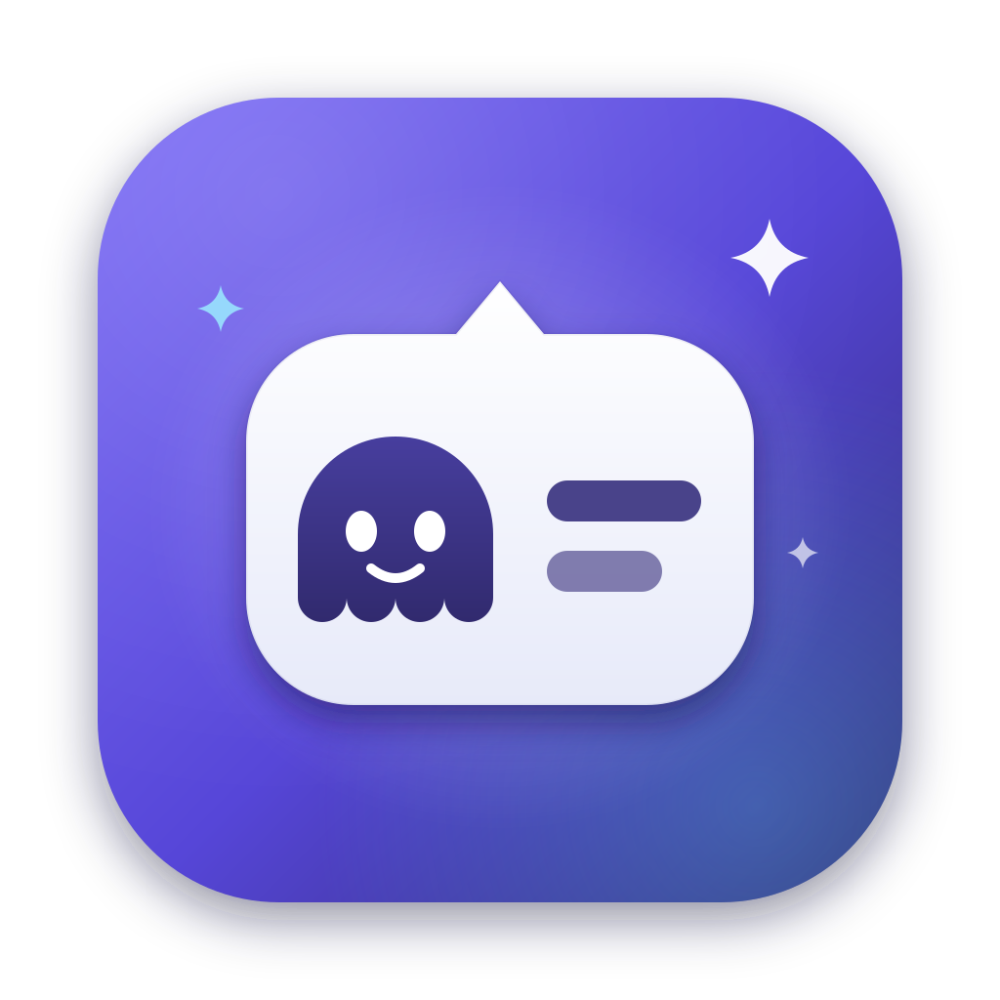

<p align="center">
  
</p>

<h1 align="center">Ghostwriter</h1>

<p align="center">
  A native macOS quick-translation &amp; writing assistant that lives in a speech bubble at your caret.<br/>
  Press <kbd>⌃</kbd><kbd>⌘</kbd><kbd>G</kbd> anywhere. Type. Hit <kbd>⌘⏎</kbd>. Keep writing.
</p>

---

Ghostwriter is inspired by macOS's native Character/Emoji picker (<kbd>⌃⌘Space</kbd>). Instead of emoji, it opens a minimalist conversation bubble attached to your text caret in **any** app — Slack, Notes, Messages, Chrome, Xcode, you name it. Write in any language (or messy syntax), and Ghostwriter either:

1. **Translates** into a target language & regional dialect (e.g. `pt-BR → en-US`), or
2. **Improves & proofreads** within the same language (e.g. `pt-BR → pt-BR`), fixing grammar, spelling, and punctuation while adapting the tone.

When you press <kbd>⌘⏎</kbd>, the result is inserted directly at your cursor — no window switching, no copy-paste.

## How it works

1. Press <kbd>⌃⌘G</kbd> (configurable) while typing in any app.
2. A floating glass speech bubble pops up **right beneath your caret** (via the macOS Accessibility API). If you had text selected, it's pre-filled as the input.
3. Type or edit the text, pick source/target language and tone.
4. Hit <kbd>⌘⏎</kbd>. Ghostwriter runs your local AI CLI, sanitizes the output, and pastes the result straight back into the app you were typing in.

## Features

- 🫧 **Caret-anchored popup** — liquid-glass speech bubble with a dynamic arrow pointing at your cursor; flips above the caret near screen edges, falls back to the mouse position.
- 🌍 **18 locales** — regional dialects, not just languages: `pt-BR` vs `pt-PT`, `en-US` vs `en-GB`, `es-ES` vs `es-419`, `fr-FR` vs `fr-CA`, and more.
- ✨ **Smart mode switching** — same-language pairs become *Improve & Insert* (proofreading), cross-language pairs become *Translate & Insert*; dialect pairs convert vocabulary and grammar between variants.
- 🎭 **Five tones** — Formal, Informal, Concise, Friendly, Academic.
- 🧠 **Zero API keys** — powered by AI CLIs you already have installed (`agy`, `claude`, `opencode`, or any custom binary).
- 📋 **Context-aware prompts** — reads surrounding text (up to ~2000 chars) as tone/topic context; it's never translated or echoed back.
- 🖥 **Menu bar resident** — agent app, no Dock icon; hotkey or status-bar activation.
- ⚡ **Live preferences** — everything configured in `~/.config/ghostwriter/prefs.toml`, hot-reloaded on save.
- 🌐 **English & Brazilian Portuguese** UI localization.

## Requirements

- macOS 26.6 or later
- Xcode (to build)
- At least one AI CLI on your `PATH` — [`agy`](https://antigravity.google) (Google Antigravity CLI), [`claude`](https://claude.com/claude-code) (Claude Code), or [`opencode`](https://opencode.ai)
- **Accessibility permission** granted to Ghostwriter (System Settings → Privacy & Security → Accessibility). Required to locate your caret and to insert text via synthetic <kbd>⌘V</kbd>. The app prompts for this on first use.

## Build & run

```bash
git clone <this repo> && cd ghostwriter
xcodebuild -scheme ghostwriter -destination 'platform=macOS' build
open "$(xcodebuild -scheme ghostwriter -destination 'platform=macOS' -showBuildSettings 2>/dev/null | grep -m1 ' TARGET_BUILD_DIR = ' | awk '{print $3}')/ghostwriter.app"
```

Or simply open `ghostwriter.xcodeproj` in Xcode and press <kbd>⌘R</kbd>.

On first launch, grant Accessibility permission when prompted, then press <kbd>⌃⌘G</kbd> in any text field.

## Configuration

All settings live in **`~/.config/ghostwriter/prefs.toml`** (created on first launch). Click the gear icon in the popup — or the menu bar item — to open it in your editor. Saving reloads instantly; the hotkey even re-registers on the fly.

| Key                 | Default        | Description                                                                 |
| ------------------- | -------------- | --------------------------------------------------------------------------- |
| `shortcut`          | `"ctrl+cmd+g"` | Global activation hotkey (e.g. `"cmd+shift+space"`, `"ctrl+opt+g"`)          |
| `provider`          | `"agy"`        | AI CLI: `"agy"`, `"claude"`, `"opencode"`, or `"custom"`                     |
| `source_language`   | `"pt-BR"`      | Source language or `"auto"` for detection                                   |
| `target_language`   | `"en-US"`      | Target language/dialect                                                      |
| `tone`              | `"formal"`     | `"formal"`, `"informal"`, `"concise"`, `"friendly"`, `"academic"`            |
| `auto_paste`        | `true`         | Automatically insert the result into the active app                          |
| `agy_path`          | *(auto)*       | Optional explicit path; otherwise discovered on your `PATH`                  |
| `claude_path`       | *(auto)*       | Optional explicit path                                                       |
| `opencode_path`     | *(auto)*       | Optional explicit path                                                       |
| `custom_binary_path`| —              | Binary for `provider = "custom"`                                             |
| `custom_arguments`  | `"{prompt}"`   | Argument template; `{prompt}` is replaced with the built prompt              |

Binary paths are auto-discovered in `~/.local/bin`, `~/.opencode/bin`, `~/.gemini/antigravity-cli/bin`, `/opt/homebrew/bin`, `/usr/local/bin`, and friends.

<details>
<summary><strong>Supported languages</strong></summary>

Auto-detect (`auto`) plus: pt-BR, pt-PT, en-US, en-GB, es-ES, es-419 (Latin American), fr-FR, fr-CA, de-DE, it-IT, ja-JP, zh-CN, zh-TW, ru-RU, ko-KR, nl-NL.

</details>

## Why CLI providers instead of an API?

No accounts, no API keys, no per-request billing, and your existing tool's auth and model config just work. Output is sanitized (ANSI escape sequences and Markdown fences stripped) before insertion. Any stdin/stdout CLI can be used through the `custom` provider.

## Development

```bash
# Build
xcodebuild -scheme ghostwriter -destination 'platform=macOS' build

# Unit tests (fast, headless)
xcodebuild test -scheme ghostwriter -destination 'platform=macOS' -only-testing:ghostwriterTests
```

Architecture, subsystem diagrams, and contribution conventions (localization rules, `@Observable` state management, sandbox constraints, etc.) are documented in [AGENTS.md](AGENTS.md). The app **must not be sandboxed** — the kernel forbids sandboxed apps from posting synthetic keystrokes to other processes.

Icon source (SVG) lives in [`.icon-design/icon.svg`](.icon-design/icon.svg).
